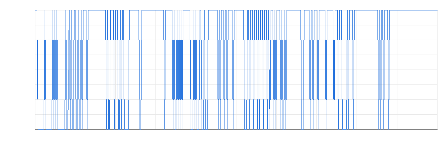

# dm40-skill — 让 Agent 直接操作 DM40 万用表

一个 **Agent Skill**（不是 MCP、不是守护进程）：通过 USB 的 USBTMC/SCPI 直接读
正点原子 DM40 万用表（DM40A/B/C）的读数、抓示波器波形、看屏幕，一条命令一次调用。



*`dm40.py scope` 抓的 400 点屏上波形（无表笔，约 9.5 mV 噪声），0.4 秒。*

```
$ dm40.py idn
Alientek,DM40B,<meter-uid>,opendm40 0.4.1

$ dm40.py read -n 3 --func dcv
7.27939e-05 V
7.88236e-05 V
7.86157e-05 V
```

## 为什么不用厂商上位机

| | |
|---|---|
| 无 MCP | 没有常驻服务、没有端口、没有 schema；就是 shell 命令 |
| 无驱动 | macOS/Linux 上用 libusb 直连 USBTMC 接口，不装 VISA |
| 只读安全 | 白名单硬编码在脚本里，电流档/发生器/固件更新/写盘一律拒绝 |
| 可组合 | 输出文本或 JSON，接管道、接 `jq`、接任何 Agent 工具链 |

## 环境要求

- 表已刷 [opendm40](https://github.com/opendm40/opendm40) 0.4.x（本项目**不含**厂商固件）
- macOS 或 Linux，USB 直连（不要 Hub）
- Python ≥ 3.10 与 `pyusb`
- 设备枚举为 `1209:d040`，产品名 `DM40 multimeter (opendm40)`

## 安装

```sh
git clone https://github.com/SinKy-Yan/dm40-skill.git ~/.agents/skills/dm40
~/.agents/skills/dm40/scripts/setup.sh      # 私有 venv + pyusb
```

Claude/DSH 之类的 Agent 运行时只要扫描 skills 目录，就会在「操作万用表」时自动加载
`SKILL.md`。手动用也可以：

```sh
S=~/.agents/skills/dm40
$S/.venv/bin/python $S/scripts/dm40.py status
```

## 命令

| 命令 | 说明 |
|---|---|
| `idn` | `*IDN?`：型号、UID、固件版本 |
| `status` | 当前功能、档位、分辨率、触发状态、采样率、错误队列 |
| `read -n N --func X [--interval S]` | 连续读数 |
| `measure X` | 单次测量（自动切功能） |
| `scope [--points screen\|max\|N] [-o wave.csv]` | 抓波形，按 preamble 换算成 `time_s,volt` |
| `screen -o meter.png` | 读 480×320 帧缓冲存 PNG（RGB565 近似） |
| `raw 'SCPI'` | 白名单内的任意 SCPI，多条用 `;` 分隔 |

功能别名：`dcv acv acdcv autov res cont diode cap freq temp`（**没有电流档**，刻意的）。

`--json` 是全局开关，必须放在子命令前面：`dm40.py --json read -n 3`。

## 安全边界

脚本在发送前逐条检查 SCPI，命中即退出、一个字节都不发：

- 电流（`CURR`）与功率计（`POW`）——防止把表留在 A 插孔烧保险/分流器
- `DBG:UPLOAD/UPDATE/RECOVER`、`FLASH`、`*RST`、`SYST:PRES`——防变砖
- `MMEM:DEL/COPY`、`LOG:*`——不写表内磁盘
- `SOUR:*`、`OUTP`——不打开信号发生器
- `CAL*`——不动校准
- `DBG:` 整体拒绝，唯一例外是只读的 `DBG:LCD?`（抓屏）

允许的最坏情况：切功能、改示波器时基/量程/触发、读屏。下一条命令会重新 `CONF`。

## 实现要点（踩过的坑）

- **USBTMC 1.0**：12 字节头，`DEV_DEP_MSG_OUT` / `REQUEST_DEV_DEP_MSG_IN`，
  每条命令后设备才发回复；
- **大块回复会拆成多条 USB 消息**：`WAV:DATA?`、`DBG:LCD?` 必须按 IEEE 488.2 块长度
  循环拼装，不能假设「一条消息 = 一个回复」；
- **LCD 单次最多约 6 KB**：抓屏按 6 行一批（5760 B）读，再由 RGB565 还原；
- **macOS 没有 USBTMC 内核驱动**，libusb 直接 claim interface 0 即可；
- 表的 U 盘是固件动态生成的只读卷，反复重连会在 Finder 留下幽灵图标，`killall Finder` 即可清掉。

## 便携包（无 venv / 无 pip / 无网络）

懒得 clone 的话，用 Release 里的 139 KB 自包含包（pyusb 已内置）：

```sh
curl -LO https://github.com/SinKy-Yan/dm40-skill/releases/download/v0.1.0/dm40-kit.tar.gz
tar xzf dm40-kit.tar.gz
./run idn
```

只要机器上有 Python 3 和 libusb（macOS `brew install libusb`）。

## 文档

| 文件 | 内容 |
|---|---|
| [docs/VERIFY.md](docs/VERIFY.md) | 真机验证记录（DM40B + opendm40 0.4.1） |
| [docs/FLASHING.md](docs/FLASHING.md) | 刷机/回退/救砖笔记（维护操作，风险自负） |
| [notes/aa-font-feasibility.md](notes/aa-font-feasibility.md) | 中文点阵字体抗锯齿的可行性调研（与 skill 无关，留作参考） |

## 验证

`docs/VERIFY.md` 是 2026-11-13 在 DM40B + opendm40 0.4.1 上的实测记录：
`*IDN?`、`READ?`、400 点波形、480×320 抓屏，以及离线单测（guard / 帧格式 / preamble 解码）。

```sh
python3 tests/test_dm40.py
```

## 许可

MIT（见 `LICENSE`）。与正点原子、opendm40 项目均无隶属关系；
DM40 与 Alientek 是各自权利人的名称，本项目仅用于标识硬件。
仓库不包含任何厂商固件。
