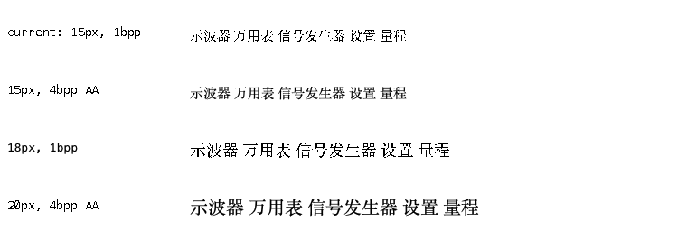

# 中文字库抗锯齿：可行性分析（笔记）

> 与 skill 本身无关，是 DM40 固件中文显示的调研记录，留作后续开发参考。

# 中文字体抗锯齿：可行性分析（2026-11-13）

## 现状

- 中文版把汉字塞进原厂 **TEXT22** 字体：22 px 字格、**1 bpp**、按墨迹裁剪；
- 补进去的 297 个汉字实际是 **15 px** 渲染后二值化（`docs/开发记录.md`：「补进去的汉字用 15 px 渲染，视觉上略小但清晰」）——
  字号小 + 二值化，是「显示很差」的主因；
- 渲染层**本来就支持 16 级灰度混合**（`stockfont.rs` 的 `alpha()` 0..15 与 `mix` 按覆盖率插值），
  HUF/RAW4 都是既有的 4 bpp 格式。也就是说：**缺的不是代码，是字库数据和放它的空间。**

## 空间预算

| 区域 | 余量 |
|---|---|
| B 区（零等待 flash） | ≈ 5.5 KB |
| C 区（慢速 flash） | ≈ 3.4 KB |
| 镜像总余量（`0x0809ed80` → `0x080A0000`） | **4,736 B** |

实测（宋体、194 个真实 UI 用字、含 10 B 条目与对齐）：

| 方案 | 总字节 | 相对 15px 1bpp |
|---|---|---|
| 15px 1bpp（现状） | 6,348 | — |
| 20px 1bpp | 10,016 | +3.7 KB |
| 20px 2bpp | 20,480 | +14 KB |
| 15px 4bpp | 23,348 | +17 KB |
| 20px 4bpp | 38,476 | +32 KB |

按 401 字放大：全量 4bpp 约 **+30～40 KB**，超出可用余量 3～4 倍；
**20px 1bpp 约 +6～7 KB，勉强塞得进 9 KB 余量。**

## 三条路

| 路线 | 内容 | 代价 | 风险 |
|---|---|---|---|
| A. 先放大 | 15px → 18–20px，仍 1bpp；重栅格化（宋体加粗/更好阈值） | +6～7 KB，基本能塞 | 低；不是 AA，但可读性提升最大 |
| B. 全量 AA | 字库改 HUF 4bpp（上游已有该编码，Huffman 压缩），20px 灰度 | 原始 38 KB → 压缩后估 15～20 KB，需再腾 6～10 KB | 中；要改字库生成与重构建 |
| C. 彻底 | 汉字字库搬到 16 MB SPI Flash，RAM 字形缓存（32 字 ×200 B ≈ 6 KB），随便 4bpp/20px | 改 font 层 ~2–3 KB 代码 + 缓存 | 中高；改动面最大 |

## 硬前提

`OpenDM40-Chinese` 只公开了 v0.3.0 线的补丁；**zh9–zh11（v0.4.0/0.4.1）的汉化补丁没有随仓库发布**
（README「从源码重建」明说）。所以任何字库改动都要先能重构建中文版：

1. 拿到作者的 v0.4.1 汉化补丁（提 issue / 联系作者），或
2. 我们自己做一份可维护的中文分支（fork 上游 v0.4.1，重做文案 + 字库），或
3. 只做二进制数据替换（不重编译）：可行但脆弱，字库 blob 地址是编译期常量，扩容空间受限。

## 建议

1. 先提 issue 给 zh 作者：请求「20px + 4bpp/HUF」版本（他们有源码，最快）；
2. 并行由我们做 A（20px 1bpp），用最小改动验证效果；
3. 拿到补丁后上 B，必要时 C。

对比图（15px 1bpp / 15px 4bpp / 18px 1bpp / 20px 4bpp）：

